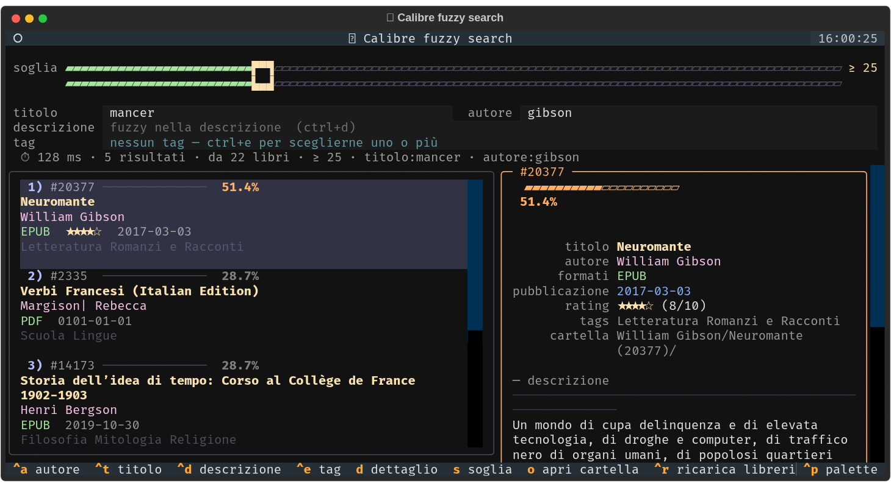
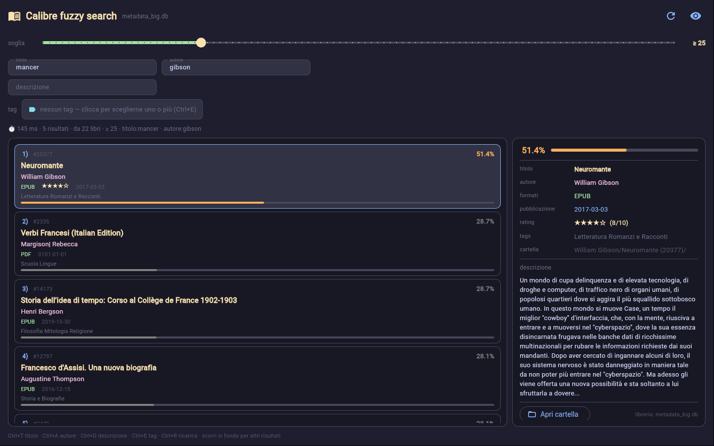

# fscalibre — ricerca fuzzy sulla tua libreria Calibre

Trovi un libro ma ricordi solo una parola del titolo? Un autore ma non sai
come si scrive? Un argomento letto in una descrizione mesi fa? `fscalibre`
cerca nella tua libreria [Calibre](https://calibre-ebook.com/) in modo
**fuzzy e combinabile**, tollerante ai refusi, su decine di migliaia di libri.

Due interfacce, **lo stesso motore e gli stessi risultati**:

- **TUI** (`calibrefind.py`, [Textual](https://textual.textualize.io/)) — nel terminale, tutta da tastiera
- **GUI** (`calibrefind_flet.py`, [Flet](https://flet.dev/)) — finestra desktop o server web, dal browser

| TUI (terminale) | GUI Flet (browser) |
|---|---|
|  |  |

## Come funziona la ricerca

Quattro criteri **indipendenti e combinabili** — un libro entra nei risultati
solo se li soddisfa **tutti** (AND):

| Criterio | Opzione | Comportamento |
|---|---|---|
| Titolo | `-t "mancer"` | fuzzy, tollerante ai refusi |
| Autore | `-a "gibson"` | fuzzy |
| Descrizione | `-d "cyberspazio"` | fuzzy, dentro il testo delle descrizioni |
| Tag | `-g Fantascienza -g Cyberpunk` | filtro esatto: il libro deve avere **tutti** i tag indicati |

Dentro un campo, le parole della query si combinano in AND (sottostringa;
quelle di 1–2 lettere come parola intera). Con una sola parola la ricerca
resta fuzzy: `mancer` trova `Neuromancer`, `gibsn` trova `Gibson`.

Lo **slider della soglia** (0–100) regola in tempo reale quanto stretti
devono essere i match: alzandola restano solo i più vicini.

Le **copie della stessa opera** (stesso titolo+autore, formati diversi)
vengono fuse in un solo risultato — tranne quando filtri per tag, caso in
cui contano le copie singole.

I risultati **non hanno un limite fisso**: la lista si allunga a pagine
mentre la scorri.

## Installazione

```bash
git clone https://github.com/vigliafg/fscalibre.git
cd fscalibre
python3 -m venv .venv
.venv/bin/pip install textual rapidfuzz          # per la TUI
.venv/bin/pip install flet flet-web flet-desktop # per la GUI (facoltativa)
```

Serve solo **Python 3.10+**: tutto il resto sono i due pacchetti sopra
(`rapidfuzz` è facoltativo anche per la TUI — senza, si usa `difflib` della
stdlib, stesso algoritmo ma ~100× più lento).

### La libreria

Il programma legge il database Calibre `metadata.db` **in sola lettura** —
non modifica mai la libreria. Lo cerca in quest'ordine:

1. la variabile d'ambiente `CALIBRE_LIBRARY`
2. `~/CalibreLibrary/metadata_big.db` (solo nei launcher, vedi sotto)
3. `~/CalibreLibrary/metadata.db`
4. qualsiasi percorso, con `-l /percorso/metadata.db`

## Uso

### TUI (terminale)

```bash
./cfind                                   # libreria di default
./cfind -a "gibson" -t "mancer"           # criteri combinati
./cfind -g Fantascienza -g Cyberpunk      # libri con TUTTI i tag
./cfind -l /percorso/altro/metadata.db    # un'altra libreria
```

Tasti principali (sempre nel footer):

| Tasto | Azione |
|---|---|
| `ctrl+a` / `ctrl+t` / `ctrl+d` / `ctrl+e` | vai al campo autore / titolo / descrizione / tag |
| `invio` | vai ai risultati |
| `d` | mostra/nasconde il dettaglio del libro |
| `o` | apre la cartella del libro |
| `s` | focus sullo slider della soglia (frecce ±1, `home`/`end` = 0/100) |
| `plus` / `minus` | alza/abbassa la soglia |
| `ctrl+r` | ricarica la libreria |
| `q` | esci |

Lo slider si trascina anche col mouse (clic o drag).

### GUI Flet (desktop o browser)

```bash
./cfindf                                  # finestra desktop
./cfindf --web                            # server web su http://127.0.0.1:8550
./cfindf --web --host 0.0.0.0             # raggiungibile dalla rete locale
./cfindf -a gibson -t mancer              # stesse opzioni della TUI
```

Senza un display grafico (es. su un server) passa da solo alla modalità web.
Le opzioni `-a -t -d -g -l -n -m` sono identiche a quelle della TUI.

### Opzioni comuni

```
-a, --author QUERY      query autore (fuzzy)
-t, --title QUERY       query titolo (fuzzy)
-d, --desc QUERY        query dentro le descrizioni (fuzzy)
-g, --tag TAG           tag richiesto; ripetibile (AND)
-l, --library PATH      percorso di metadata.db
-n, --page-size N       risultati disegnati per pagina (default 30)
-m, --min-score N       score minimo 0-100 (default 30)
```

## Prestazioni

- **Cache del db**: la prima indicizzazione di una libreria grande richiede
  ~15 s; il risultato viene salvato in `metadata.db.cache.pkl` (pickle+zlib,
  ~20 MB) accanto al db e si ricarica in ~1 s. La cache si invalida da sola
  quando il db cambia (mtime) o cambia la versione del formato.
- **Scansione parallela**: la ricerca fuzzy gira su un pool di processi
  (fino a 6), quindi resta reattiva anche su librerie di decine di migliaia
  di libri.
- `rapidfuzz` (C++) se installato: stesso algoritmo di `difflib` ma ~100×
  più veloce. Il fallback stdlib è automatico.

## Architettura

```
cfcore.py            motore headless: normalizzazione, cache, scansione
  ↑        ↑          fuzzy multi-processo, fusione copie, indice tag
  │        │          (nessuna UI: importabile e scriptabile)
calibrefind.py   calibrefind_flet.py
TUI Textual          GUI Flet (desktop/web)
```

Tutta la logica di ricerca vive in `cfcore.py`; le due interfacce sono solo
presentazione, per questo mostrano **esattamente gli stessi risultati con gli
stessi punteggi**. Il modulo si può usare anche da codice:

```python
from cfcore import load_books, pool_scan
books, cols = load_books("~/CalibreLibrary/metadata.db")
```

## Licenza

MIT
